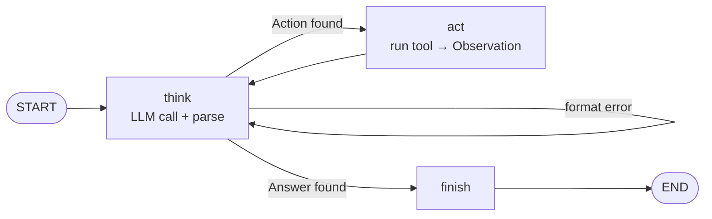
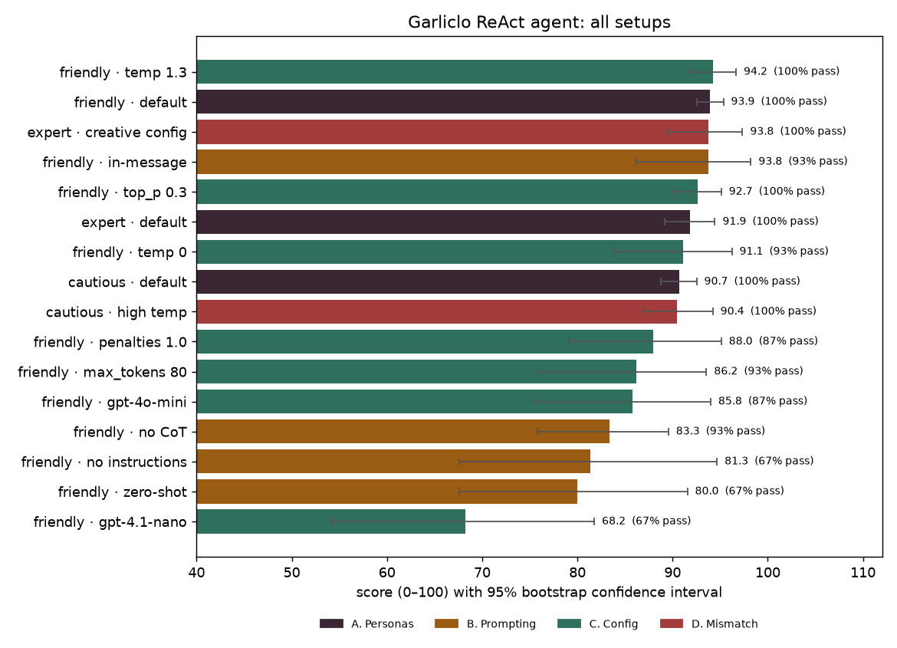

# 🧄 Garliclo ReAct Agent with Configurable Personas

**EECE 503P/798S: Agentic Systems — C4: Agent Personas & Thinking Mechanisms**

The C3 Garliclo business chatbot, rebuilt as a **ReAct agent in LangGraph**. The Thought → Action → Observation loop is
written by hand as graph nodes and conditional edges; no prebuilt executor is used. Three personas, each defined by
prompt traits **and** a matching LLM configuration, are compared across prompt-engineering variants and configuration
sweeps on a 10-case test set.

## Grading map

| Item | Points | Notebook section |
|---|---|---|
| Use-case summary and write-up | 10 | §1 |
| ReAct logic manually implemented | 30 | §3 tools · §7 prompt · §8 LangGraph loop · §9 demo |
| Persona design (prompt and configuration) | 20 | §5 |
| Configuration experimentation and comparison | 15 | §10–§12 |
| Clear instructions design | 10 | §4 |
| Creativity, clarity, and reflection quality | 15 | §13 reflection · Gradio app |

## The ReAct loop



`think` calls the model with the stop sequence `Observation:` and parses `Thought:` / `Action: tool({...})` /
`Answer:`. `act` runs the tool and feeds its result back as the next observation (at most 6 steps).

## Personas

| | 😊 Friendly Advisor | 🧑‍🍳 Strict Expert | 🛡️ Cautious Helper |
|---|---|---|---|
| Task | sales and first contact | exact quotes and planning | complaints and support |
| temperature / top_p | 0.7 / 0.9 | 0.1 / 0.5 | 0.3 / 0.8 |
| frequency / presence penalty | 0.3 / 0.3 | 0 / 0 | 0.1 / 0 |

## Results (16 setups × 15 cases, personas repeated 3×, 95% confidence intervals)



* **Best:** Friendly Advisor + Chain-of-Thought + few-shot + instructions block. It scored 93.9 (CI 92.5–95.3) over
  45 runs with 100% of checks passed. Its configuration variants are ties within the 1.5-point run-to-run noise.
* **Persona-task fit:** each persona scored best on its own task. The Strict Expert is rated 4.60/5 on quotes but
  2.07 on support; the Cautious Helper 4.80 on support but 2.33 on quotes.
* **Instructions block:** removing it dropped success from 100% to 67% and logging to 0%, while the judge still rated
  its tone highly.
* **Prompting:** dropping Chain-of-Thought (83.3) or the few-shot examples (80.0) clearly hurt.
* **Model type:** `gpt-4.1-nano` fell to 67% success; `gpt-4o-mini` made 13 format errors.
* **top-k:** not offered by OpenAI, and ignored by the current Gemini API: top_k = 1 still gave 5 different outputs.

All runs are logged in [`experiments/`](experiments/). The full analysis and reflection are in the notebook.

## Run it

```bash
python -m venv .venv
.venv\Scripts\activate
pip install -r requirements.txt
copy .env.example .env      # add OPENAI_API_KEY (and GEMINI_API_KEY for the top-k probe)
python app.py               # or open c4_react_agent.ipynb and Run All
```

The notebook loads the logged experiment results; set `RUN_EXPERIMENTS = True` in §10 to re-run all 330 runs.

## Files

| File | Purpose |
|---|---|
| [`c4_react_agent.ipynb`](c4_react_agent.ipynb) | Main notebook: use case, tools, instructions, personas, ReAct loop, experiments, reflection |
| [`garliclo_react.py`](garliclo_react.py) | The agent (same code as notebook §0–§8), imported by the app |
| [`app.py`](app.py) | Gradio app: choose a persona, tune prompt and configuration, watch the ReAct trace |
| [`experiments/`](experiments/) | Logged runs (`results.jsonl`), summaries, chart, sampling probe |
| [`me/`](me/) | Garliclo business summary and PDF profile (from C3) |
